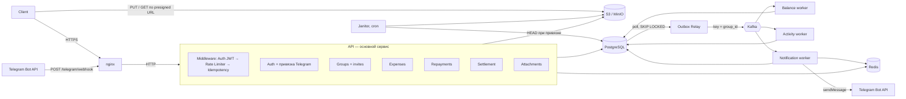

# SplitPay — дизайн системы

Распределённый сервис учёта групповых расходов и расчёта долгов (аналог Splitwise).
Курсовая работа, 2-й курс ФКН ВШЭ, ПИ.

Документ фиксирует принятые решения. Если меняется решение, меняется и этот файл.
Схема БД — в [`migrations/000001_init.up.sql`](../migrations/000001_init.up.sql).
Визуальная схема архитектуры и ER-диаграмма — в `docs/architecture.excalidraw` (открывается на excalidraw.com).

---

## 1. Стек

| Что | Чем |
|---|---|
| Язык | Go |
| БД | PostgreSQL 16, миграции — golang-migrate |
| Кэш, rate limit, одноразовые токены | Redis |
| Очередь событий | Kafka (KRaft, без ZooKeeper) |
| Файлы | S3-совместимое хранилище: MinIO |
| Уведомления | Telegram Bot API |
| Вход | nginx (reverse proxy, TLS) |
| Деплой | Docker Compose на VPS |
| Логи | `log/slog` |
| Пароли | bcrypt |

---

## 2. Термины

| Термин | Значение |
|---|---|
| **Expense** (расход) | «Вася заплатил 3000 ₽ за пиццу». Есть плательщик, автор и доли участников |
| **Split** (доля) | Сколько конкретный участник должен по расходу. Сумма долей = сумма расхода |
| **Repayment** (перевод) | Факт передачи денег: «Петя перевёл Васе 1500 ₽» (банком или наличными). Можно записать в любой момент |
| **Settlement** (расчёт) | Вычисление плана «кто кому сколько перевести», чтобы все долги обнулились. В БД не хранится |
| **Balance** (баланс) | Чистая позиция участника в группе: `>0` — ему должны, `<0` — должен он |
| **Activity** (лента) | История событий группы: «Вася добавил расход „Пицца“» |

---

## 3. Бизнес-правила

- **Одна валюта** на всё приложение. Все суммы — в копейках, `BIGINT`. Никаких `float`.
- **Деление расхода:** `equal` (поровну) или `exact` (точные суммы). Копеечный остаток при делении поровну **разыгрывается случайно один раз при создании** и сохраняется в `expense_splits`. Повторно доли не пересчитываются.
- **Расход нельзя редактировать.** Можно только удалить, и **удалить может только автор** (`created_by`). Удаление мягкое (`deleted_at`).
- **Выйти из группы нельзя.** Участники только добавляются (по ссылке-приглашению).
- В группе ровно один `owner` (роль в `group_members`). **Только owner** выпускает и отзывает ссылку-приглашение.
- Одна активная ссылка-приглашение на группу, живёт 24 часа: новая заменяет старую.
- **Перевод (repayment)** записывает отправитель или получатель — третьи лица не могут (`CHECK (created_by IN (from_user_id, to_user_id))`). Удалить перевод может только автор записи, удаление мягкое.
- Другие участники группы видят только имя участника, email — нет (email виден только в своём профиле).
- Плательщик расхода, отправитель и получатель перевода обязаны быть участниками группы (составные FK на `group_members`).
- Нельзя перевести деньги самому себе.
- Удаление расхода после переводов допустимо: балансы честно пересчитаются, и может оказаться, что теперь получатель перевода должен отправителю.

---

## 4. Архитектура

Модульный монолит (API) + асинхронные проекции через transactional outbox и Kafka.



### Компоненты

| Компонент | Процесс | Ответственность |
|---|---|---|
| **nginx** | контейнер | TLS, проксирование, грубый rate limit по IP (`limit_req`), лимит размера запроса, таймауты. Авторизацией и бизнес-логикой не занимается |
| **API** | `cmd/api` | Все HTTP-ручки. Модули: Auth, Groups, Expenses, Repayments, Settlement, Attachments |
| **Outbox Relay** | `cmd/relay` | Переносит события из таблицы `outbox` в Kafka |
| **Balance worker** | `cmd/balance-worker` | Поддерживает таблицу `balances` |
| **Activity worker** | `cmd/activity-worker` | Поддерживает ленту `activity` |
| **Notification worker** | `cmd/notification-worker` | Шлёт сообщения в Telegram |
| **Janitor** | `cmd/janitor` (cron, раз в сутки) | Чистит устаревшие данные |

Масштабирование пока не делаем: по одной реплике каждого процесса. Но архитектура это допускает (API без состояния, Relay с `SKIP LOCKED`, воркеры в consumer groups).

---

## 5. Путь HTTP-запроса

```
Client → nginx → [Auth Middleware] → [Rate Limiter] → [Idempotency Middleware] → handler → service → repository
```

- **Auth Middleware** проверяет подпись и `exp` access-токена локально, без похода в БД. Кладёт `user_id` в `context`.
- **Rate Limiter** — по `user_id`, счётчики в Redis (`INCR` + TTL). По IP режет nginx.
- **Idempotency Middleware** — см. раздел 7. Стоит после Auth, потому что ключ привязан к `user_id`.
- `/telegram/webhook` **исключён из Auth Middleware**, у него своя проверка (раздел 12).

### Формат ошибок

Все ошибки API — JSON одного вида, `Content-Type: application/json`:

```json
{
  "error": {
    "code": "validation_failed",
    "message": "Некорректные данные запроса",
    "details": { "email": "Неверный формат email адреса" }
  }
}
```

- `code` — стабильный машинный код в `snake_case`, на него опирается клиент.
- `message` — текст для человека, может меняться.
- `details` — необязательно; для ошибок валидации — поле → сообщение.

Ответ формирует **одна функция** `writeError(w, r, err)`: доменная ошибка → статус и код через `errors.Is`. Хендлеры не вызывают `http.Error` и не пишут статусы ошибок сами. Неизвестная ошибка → `500 internal`, детали пишутся только в лог, клиенту — общий текст.

| Доменная ошибка / ситуация | HTTP | `code` |
|---|---|---|
| Невалидный JSON, слишком большое тело | 400 | `invalid_body` |
| Ошибка валидации полей | 400 | `validation_failed` |
| Приглашение истекло | 400 | `invite_expired` |
| Нет / неверный / истёкший access-токен | 401 | `unauthorized` |
| Неверный email или пароль | 401 | `invalid_credentials` |
| Неверный, отозванный или истёкший refresh-токен | 401 | `invalid_refresh_token` |
| Не участник группы, не автор расхода | 403 | `forbidden` |
| Сущность не найдена | 404 | `not_found` |
| Email уже занят | 409 | `email_taken` |
| `Idempotency-Key` повторно с другим телом | 422 | `idempotency_key_mismatch` |
| Превышен rate limit (+ заголовок `Retry-After`) | 429 | `rate_limited` |
| Всё остальное | 500 | `internal` |

### Список ручек (`/api/v1`)

Полный контракт — [`swagger.yaml`](../swagger.yaml) (OpenAPI 3.0). 🔒 — нужен access-токен; 👥 — только участник группы; 🔑 — обязателен `Idempotency-Key`.

| Метод и путь | Доступ | Что делает |
|---|---|---|
| `POST /auth/sign-up` | — | Регистрация (email, пароль 8–72 байт, имя) |
| `POST /auth/sign-in` | — | Вход → access + refresh |
| `POST /auth/refresh` | — | Ротация пары токенов |
| `POST /auth/logout` | — | Отозвать refresh-токен (идемпотентно) |
| `GET /me`, `PATCH /me` | 🔒 | Профиль, смена имени; `telegram_linked` |
| `POST /me/telegram/link` | 🔒 | Ссылка `t.me/<bot>?start=<токен>` (TTL 10 мин) |
| `DELETE /me/telegram` | 🔒 | Отвязать Telegram |
| `POST /groups` | 🔒 | Создать группу (создатель — owner) |
| `GET /groups` | 🔒 | Мои группы с моей ролью и балансом |
| `POST /groups/join` | 🔒 | Вступить по токену приглашения (идемпотентно) |
| `GET /groups/{id}` | 🔒👥 | Группа и участники |
| `POST /groups/{id}/invite` | 🔒👥 owner | Новое приглашение на 24 ч (старое перестаёт действовать) |
| `DELETE /groups/{id}/invite` | 🔒👥 owner | Отозвать приглашение |
| `POST /groups/{id}/expenses` | 🔒👥🔑 | Создать расход (`equal` / `exact`, чек) |
| `GET /groups/{id}/expenses` | 🔒👥 | Расходы, keyset-пагинация |
| `GET /groups/{id}/expenses/{eid}` | 🔒👥 | Расход с долями и ссылкой на чек |
| `DELETE /groups/{id}/expenses/{eid}` | 🔒👥 автор | Мягкое удаление (идемпотентно) |
| `POST /groups/{id}/repayments` | 🔒👥🔑 | Записать перевод (только отправитель или получатель) |
| `GET /groups/{id}/repayments` | 🔒👥 | Переводы, keyset-пагинация |
| `GET /groups/{id}/repayments/{rid}` | 🔒👥 | Перевод со скриншотом |
| `DELETE /groups/{id}/repayments/{rid}` | 🔒👥 автор | Мягкое удаление (идемпотентно) |
| `GET /groups/{id}/balances` | 🔒👥 | Балансы из проекции (+ `updated_at`) |
| `GET /groups/{id}/settlement` | 🔒👥 | План расчёта (раздел 10) |
| `GET /groups/{id}/activity` | 🔒👥 | Лента, keyset-пагинация |
| `POST /attachments/upload-url` | 🔒 | Presigned PUT в S3 (раздел 11) |
| `POST /telegram/webhook` | секрет | Только для Telegram (раздел 12) |
| `GET /healthz`, `GET /readyz` | — | Liveness / readiness |

Соглашения: refresh-токен передаётся в теле (фронтенда нет, cookie не используем); списки — `limit` (≤ 100) + `cursor`, ответ `{items, next_cursor}`; создание → `201` с телом, удаление → `204`.

---

## 6. Аутентификация (JWT access + refresh)

1. `signIn` → **access** (JWT, 15 мин) + **refresh** (30 дней).
2. Каждый запрос: `Authorization: Bearer <access>`, проверка без БД.
3. Access истёк → `POST /auth/refresh` → новая пара токенов (**ротация**), старая refresh-сессия отзывается (`revoked_at`).
4. Logout → `revoked_at = now()` у refresh-сессии.

- Оба токена передаются в теле запросов и ответов: фронтенда нет, клиент — Swagger UI / curl.
- Известное ограничение: после logout access-токен живёт до истечения (≤ 15 мин).

### Хранение секретных токенов

Касается **refresh-токенов**, **токенов приглашения в группу** и **токенов привязки Telegram**.

- Токен генерируется из `crypto/rand`: 32 байта (256 бит) → base64url без паддинга. Клиенту отдаётся сам токен.
- В БД (и в ключах Redis) хранится **только хеш**: `hex(sha256(token))`. Поиск идёт по хешу через уникальный индекс (`refresh_sessions.token_hash`, `group_invites.token_hash`; в Redis — ключ `tglink:<hash>`).
- **SHA-256, а не bcrypt**: у токена 256 бит случайности, подобрать его по хешу невозможно, а соль bcrypt сделала бы поиск по индексу невозможным. bcrypt — только для паролей.
- `uuid.New()` как секретный токен **не используем**.
- Токены никогда не пишутся в логи.

```go
// pkg/token
func New() (plain, hash string, err error) {
    b := make([]byte, 32)
    if _, err = rand.Read(b); err != nil {
        return "", "", err
    }
    plain = base64.RawURLEncoding.EncodeToString(b)
    return plain, Hash(plain), nil
}

func Hash(plain string) string {
    sum := sha256.Sum256([]byte(plain))
    return hex.EncodeToString(sum[:])
}
```

Ротация refresh — одним атомарным запросом (повторное использование того же токена получит 0 строк → `401`), новая сессия создаётся в той же транзакции:

```sql
UPDATE refresh_sessions SET revoked_at = now()
WHERE token_hash = $1 AND revoked_at IS NULL AND expires_at > now()
RETURNING user_id;
```

---

## 7. Идемпотентность API

Клиент генерирует `Idempotency-Key` (UUID) **один раз на действие пользователя** и повторяет его при ретраях. Передаётся в **заголовке**.

**Postgres — источник правды, Redis — только кэш.** Разделение на две части:

**Idempotency Middleware** (общая для всех изменяющих ручек):
1. Читает заголовок, проверяет формат, считает хеш тела запроса.
2. `GET idem:{user_id}:{key}` в Redis → если есть готовый ответ, сразу его возвращает.
3. Передаёт ключ и хеш в `context`.
4. После успешного ответа кладёт его в Redis (TTL 24 ч).

**Сервисный слой** (в той же транзакции, что и бизнес-запись):
```sql
BEGIN;
INSERT INTO idempotency_keys (user_id, key, request_hash) VALUES (...)
  ON CONFLICT (user_id, key) DO NOTHING;
-- 0 строк → повтор: хеш совпал — вернуть сохранённый ответ, не совпал — 422
INSERT INTO expenses ...; INSERT INTO expense_splits ...;
INSERT INTO outbox ...;
UPDATE idempotency_keys SET response_code = ..., response_body = ...;
COMMIT;
```

- Гонку двух одинаковых запросов решает уникальный индекс: второй INSERT ждёт коммита первого и получает конфликт.
- Падение Redis не ломает корректность, только замедляет повторы.
- PK `(user_id, key)`, а не `key`: чужой ключ не вернёт чужой ответ, кривой клиент не затронет других.
- **Удаление расхода** идемпотентно само по себе и ключа не требует:
  `UPDATE expenses SET deleted_at = now() WHERE id = $1 AND created_by = $2 AND deleted_at IS NULL RETURNING id` —
  событие `ExpenseDeleted` пишется в outbox только если строка реально обновилась.

---

## 8. События: Outbox → Kafka

### Transactional outbox

Сервис **никогда не пишет в Kafka напрямую**. Событие записывается в `outbox` в той же транзакции, что и бизнес-данные. Это убирает проблему dual write.

### Outbox Relay

Бесконечный цикл:
1. Раз в N мс: `SELECT ... FROM outbox WHERE status = 'new' ORDER BY created_at LIMIT 100 FOR UPDATE SKIP LOCKED`.
2. Публикует в Kafka, **ключ партиции = `group_id`** (`aggregate_id`) → события группы упорядочены.
3. `status = 'sent'`.
4. Kafka недоступна → **retry с backoff бесконечно**, не сдаёмся.
5. `failed` — только если событие невозможно отправить в принципе (например, слишком большое) → лог ERROR + ручная переотправка.

Гарантия доставки: **at-least-once** → все консьюмеры обязаны быть идемпотентными.

### Топики и события

| Топик | События |
|---|---|
| `expenses.events` | `ExpenseCreated`, `ExpenseDeleted` |
| `repayments.events` | `RepaymentCreated`, `RepaymentDeleted` |
| `groups.events` | `MemberJoined` |
| `<topic>.dlq` | один DLQ на каждый топик |

Правила для событий:
- У каждого события есть `event_id` (= `outbox.id`), `event_type`, `group_id`, `created_at`.
- События **несут дельты** (доли участников), чтобы порядок применения не влиял на итог. `ExpenseDeleted` содержит доли удалённого расхода для отката.
- Payload самодостаточен: потребителю не нужно ходить в чужие таблицы за базовыми данными.

---

## 9. Воркеры

У каждого воркера **своя consumer group**: `balance-worker`, `activity-worker`, `notification-worker`. Offset коммитится **после** успешной обработки.

### Balance worker

Слушает `expenses.events`, `repayments.events`.

```
BEGIN;
  INSERT INTO processed_events (consumer, event_id) VALUES ('balance-worker', $1)
    ON CONFLICT DO NOTHING;           -- 0 строк → дубль → ROLLBACK, коммит offset
  UPDATE balances ...;                -- применить дельты (*Deleted — с обратным знаком)
COMMIT;
-- затем commit offset в Kafka
```

`balances` используется **только для показа** на странице группы. Для расчёта долгов берутся честные данные (раздел 10).

### Activity worker

Слушает все топики. `INSERT INTO activity ... ON CONFLICT (event_id) DO NOTHING` — уникальный `event_id` и есть идемпотентность, отдельный inbox не нужен.

`payload` хранит **снимок** данных на момент события (имя, сумма, описание), чтобы лента не делала JOIN'ов и не ломалась после удалений.

Чтение ленты: `GET /groups/{id}`, keyset-пагинация по `(created_at, id)`, индекс `(group_id, created_at DESC, id DESC)`. **Кэша ленты нет** — запрос по индексу достаточно быстрый.

### Notification worker

Слушает `expenses.events`, `repayments.events`, `groups.events`.

1. `SET notif:{event_id} 1 NX EX 86400` в Redis. Ключ уже есть → дубль, пропускаем.
2. Получатели: `group_members` + `telegram_links` (у кого привязан Telegram).
3. `sendMessage` в Telegram. Ошибка → `DEL` ключа и retry.
4. Ответ `403` (бот заблокирован) → удалить запись из `telegram_links`.

Гарантии best-effort: редкий дубль или потеря уведомления допустимы.

### Ошибки, retry и DLQ

- **Временная ошибка** (БД, сеть, 5xx) → retry с exponential backoff + jitter: 200 мс → 400 → 800 → 1600 мс, до 5 попыток.
- **Постоянная ошибка** (битый JSON, группа не найдена — `ErrPermanent`) или попытки кончились → событие в `<topic>.dlq` с заголовками (исходный топик, партиция, offset, consumer, ошибка, число попыток), затем commit offset и следующее событие.
- Порядок «записать в DLQ → commit offset»: при падении между шагами событие окажется в DLQ дважды, это безопасно.
- DLQ — место, куда откладываются необработанные события, чтобы не блокировать партицию. **Автоматической переотправки нет** (отдельный инструмент вне рамок курсовой): события в DLQ можно только посмотреть вручную (`kafka-console-consumer` или Kafka UI) и понять причину ошибки по заголовкам.
- Алертов на DLQ нет (упрощение) — о попадании события сообщает только лог ERROR.

---

## 10. Settlement — ядро курсовой

### Честный пересчёт балансов

«Рассчитаться» **не использует** таблицу `balances` (она может отставать). Балансы считаются прямо из источника правды:

```
баланс(u) = заплатил(u) − доли(u) + перевёл(u) − получил(u)
```

```sql
SELECT user_id, SUM(delta) AS net FROM (
    SELECT payer_id AS user_id, amount AS delta
      FROM expenses WHERE group_id = $1 AND deleted_at IS NULL
    UNION ALL
    SELECT s.user_id, -s.amount
      FROM expense_splits s JOIN expenses e ON e.id = s.expense_id
     WHERE e.group_id = $1 AND e.deleted_at IS NULL
    UNION ALL
    SELECT from_user_id, amount FROM repayments WHERE group_id = $1 AND deleted_at IS NULL
    UNION ALL
    SELECT to_user_id, -amount FROM repayments WHERE group_id = $1 AND deleted_at IS NULL
) t GROUP BY user_id HAVING SUM(delta) <> 0;
```

### Алгоритмы

Реализуем **оба** и сравниваем. Алгоритм — чистый Go-пакет без БД и HTTP.

| | Жадный | Точный |
|---|---|---|
| Идея | Самый большой должник платит самому большому кредитору | Разбить участников на максимум групп с нулевой суммой; переводов = `n − k` |
| Сложность | O(n log n) | DP по подмножествам, O(2ⁿ · n) |
| Переводов | ≤ n − 1, минимум не гарантирован | Минимум |

- `n` — участники с ненулевым балансом.
- Задача минимизации числа переводов NP-трудная.
- **Бенчмарк:** случайные балансы, n = 2…25, время и число переводов → порог «до n ≤ X точный, дальше жадный».
- Свойства для тестов: переводы обнуляют все балансы; переводов ≤ n − 1; никто не платит себе.

### Ручки

- `GET /groups/{id}/settlement?algorithm=auto|greedy|exact` — посчитать план. Ничего не меняет. `auto` выбирает точный алгоритм, если `n` не больше порога из бенчмарка; `exact` сверх порога → `422 too_many_participants`. В ответе — какой алгоритм реально использован.
- Пользователь отмечает строку плана «Оплачено» → клиент создаёт **Repayment** (`POST /groups/{id}/repayments` с `Idempotency-Key`).

---

## 11. Вложения (S3)

Чек к расходу или скриншот перевода. **Файл не идёт через наш сервер.**

1. `POST /attachments/upload-url {content_type, size}` → API проверяет тип (jpeg, png, pdf) и размер (≤ 10 МБ), создаёт `attachments` со статусом `pending`, подписывает **presigned PUT URL** (≈10 мин). Подпись считается локально, без запроса в S3.
2. Клиент загружает файл **напрямую в S3** по этой ссылке.
3. При создании расхода или перевода клиент передаёт `attachment_id`. API проверяет владельца и делает `HEAD` объекта в S3 (файл есть? размер и тип совпадают?), затем в той же транзакции привязывает вложение (`status = 'attached'`).
4. Просмотр: API проверяет членство в группе и выдаёт **presigned GET URL** (≈15 мин).

- Бакет **приватный**. В БД хранится **ключ объекта** (`s3_key`), а не URL.
- Брошенные `pending` старше 24 ч удаляет Janitor (из БД и из S3).

---

## 12. Telegram

### Привязка аккаунта

Бот не может написать человеку первым, поэтому:
1. «Подключить Telegram» → API создаёт одноразовый токен и кладёт в **Redis** ключ `tglink:<sha256(токен)>` → `user_id` (TTL 10 мин) → возвращает `t.me/<bot>?start=<токен>`.
2. Пользователь жмёт Start → боту приходит `/start <токен>`.
3. Webhook считает хеш токена, находит ключ в Redis → сохраняет `(user_id, chat_id)` в `telegram_links` → удаляет ключ → отвечает «Готово».

### Webhook

- Только webhook, без long polling. `setWebhook` с `secret_token`.
- Ручка `POST /telegram/webhook`: без JWT; проверка заголовка `X-Telegram-Bot-Api-Secret-Token`, иначе `401`.
- Отвечать быстро и `200`, иначе Telegram повторит запрос. Повторы безопасны (токен одноразовый, есть `update_id`).
- Нужен публичный HTTPS → на VPS через nginx + TLS.
- **Разработка:** обычно `curl` с фейковым `Update`; для живого бота — туннель (ngrok / cloudflared) и **отдельный dev-бот** (у одного бота только один webhook).

---

## 13. Janitor (cron, раз в сутки)

`DELETE` устаревшего:
- `idempotency_keys` старше 72 ч;
- `outbox` со `status = 'sent'` старше 7 дней;
- `processed_events` старше retention Kafka + запас;
- просроченные `group_invites` и `refresh_sessions`;
- `attachments` в статусе `pending` старше 24 ч (+ объект в S3).

---

## 14. Модель данных

Полная схема: [`migrations/000001_init.up.sql`](../migrations/000001_init.up.sql).

| Домен | Таблицы |
|---|---|
| Пользователи и auth | `users`, `refresh_sessions`, `telegram_links` |
| Группы | `groups`, `group_members`, `group_invites` |
| Деньги | `expenses`, `expense_splits`, `repayments`, `attachments` |
| Проекции воркеров | `balances`, `activity` |
| Надёжность | `idempotency_keys`, `outbox`, `processed_events` |

Соглашения:
- PK — `UUID` (`gen_random_uuid()`), кроме `activity.id` (`BIGSERIAL` для стабильной пагинации).
- Деньги — `BIGINT` в копейках.
- Время — `TIMESTAMPTZ NOT NULL DEFAULT now()`.
- Перечисления — `TEXT` + `CHECK (... IN (...))`.
- `email` — `CITEXT` (регистронезависимо).
- Токены (refresh, invite) хранятся только хешами.
- **Применённые миграции не редактируются**, любое изменение — новый файл `000002_...`.

---

## 15. Принятые решения и отклонённые альтернативы

| Решение | Почему | Что отклонили |
|---|---|---|
| Модульный монолит + воркеры | Простота при честной асинхронности; модули — будущие границы сервисов | Микросервисы с первого дня |
| Transactional outbox | Нет dual write между БД и Kafka | Публикация в Kafka прямо из обработчика |
| Idempotency: PG — правда, Redis — кэш | Redis не участвует в транзакции | Только Redis (`SET NX`) |
| Inbox в PG для Balance worker | Отметка в той же транзакции, что и эффект | Ключи в Redis для воркеров |
| Redis `SET NX` для Notification | Эффект внешний, транзакции нет; дубль не критичен | — |
| Лента — таблица `activity` в PG | Нельзя восстановить ленту SQL-ом после удалений; нет гонок кэша | Кэш ленты в Redis с пересчётом |
| Settlement по сырым данным | `balances` может отставать | Расчёт по таблице `balances` |
| Один DLQ на топик, без переотправки | Проще; переотправка — вне рамок курсовой | DLQ на каждого консьюмера, CLI для replay |
| Telegram | Бесплатно, просто, наглядно на демо | Push (FCM/APNs), почта (домен, SPF/DKIM) |
| Только webhook | Меньше кода | Long polling |
| Presigned URL | Файлы не нагружают API | Загрузка через API |

---

## 16. Известные ограничения

- **Eventual consistency:** баланс на странице группы может отставать на доли секунды (расчёт долгов — точный).
- Access-токен действует до 15 мин после logout.
- Событие, попавшее в DLQ, так и не применяется: например, баланс группы на странице останется неточным (расчёт «Рассчитаться» при этом верный — он считается по сырым данным).
- Нет алертов: о попадании события в DLQ или `failed` в outbox сообщает только лог.
- Одна реплика каждого процесса, Postgres — единая точка отказа.
- Нет редактирования расходов, выхода из группы, мультивалютности.

---

## 17. План работ

**MVP (этапы 0–5, ~10 недель)** — минимум для защиты; этапы строго по порядку, после каждого система работает целиком.

| # | Этап | Оценка | Готово, когда |
|---|---|---|---|
| 0 | Каркас: `cmd/*`, Docker Compose (Postgres, Redis, Kafka, MinIO), миграции, Makefile, golangci-lint, CI | ~1 нед | `make up` поднимает окружение, миграции применяются |
| 1 | API-контракт: OpenAPI, единый формат ошибок, keyset-пагинация | ~0.5 нед | `openapi.yaml` описывает все ручки MVP |
| 2 | Auth (bcrypt, JWT + ротация refresh), middleware, группы, invite-ссылки, nginx | ~2 нед | регистрация → группа → вступление по ссылке |
| 3 | Расходы (equal/exact, остаток), мягкое удаление, переводы, идемпотентность | ~2 нед | повтор с тем же ключом не создаёт дубль |
| 4 | **Settlement**: SQL-пересчёт, жадный + точный, тесты, бенчмарк | ~2 нед | `GET /settlement` работает, графики для главы готовы |
| 5 | Outbox, Relay, Kafka, Balance worker, Activity worker, лента | ~2.5 нед | расход → баланс и лента обновились за < 1 с |
| 6 | Retry + backoff + DLQ, Janitor | ~1 нед | «отравленное» событие уходит в DLQ, воркер продолжает работу |
| 7 | Вложения: MinIO, presigned URL, `HEAD`, очистка | ~1 нед | чек прикрепляется к расходу и виден участникам |
| 8 | Telegram: привязка, webhook, Notification worker | ~1.5 нед | участники получают сообщение о новом расходе |
| 9 | Тесты: unit, testcontainers, хаос-тест, k6 (параллельно 2–8) | ~1.5 нед | CI зелёный, отчёт k6 готов |
| 10 | Наблюдаемость (опционально): `slog`, Prometheus, Grafana | ~1 нед | на дашборде видна нагрузка и lag воркеров |
| 11 | Деплой: VPS, nginx + TLS, секреты, бэкапы `pg_dump`, `setWebhook` | ~1 нед | сервис доступен по домену, демо работает |
| 12 | Текст курсовой, презентация, сценарий демо | ~2 нед | текст сдан, демо отрепетировано |

Этапы 6–8 можно переставлять или выбросить, если не хватит времени.

---

## 18. Транзакции в коде (TxManager)

Границы транзакции определяет **сервисный слой**, а не репозиторий: одна бизнес-операция часто пишет в несколько таблиц разных репозиториев (расход + доли + `idempotency_keys` + `outbox`), и всё это должно закоммититься вместе.

```go
// Общий интерфейс для pgxpool.Pool и pgx.Tx
type Querier interface {
    Exec(ctx context.Context, sql string, args ...any) (pgconn.CommandTag, error)
    Query(ctx context.Context, sql string, args ...any) (pgx.Rows, error)
    QueryRow(ctx context.Context, sql string, args ...any) pgx.Row
}

type TxManager interface {
    WithTx(ctx context.Context, fn func(ctx context.Context) error) error
}
```

- `WithTx` открывает `pgx.Tx`, кладёт её в `context` и вызывает `fn`. `fn` вернула ошибку → `Rollback`, иначе → `Commit`. Вложенный `WithTx` переиспользует уже открытую транзакцию.
- Репозиторий **сам транзакций не открывает**: берёт `Querier` из `context` (транзакция, если она есть, иначе пул) — `q := querierFrom(ctx, r.pool)`.
- Пример — создание расхода:
  ```go
  err := s.tx.WithTx(ctx, func(ctx context.Context) error {
      // 1. idempotency_keys: INSERT ... ON CONFLICT DO NOTHING
      // 2. expenses + expense_splits
      // 3. outbox: ExpenseCreated
      // 4. idempotency_keys: сохранить ответ
      return nil
  })
  ```
- **Внутри транзакции нет сетевых вызовов** (Kafka, S3, Telegram, Redis): они делаются до или после неё. Транзакция должна быть короткой.
- Уровень изоляции — `READ COMMITTED` (по умолчанию). Корректность держится на уникальных индексах, `ON CONFLICT`, условных `UPDATE ... WHERE ... RETURNING` и `FOR UPDATE SKIP LOCKED`, а не на `SERIALIZABLE`.

---

## 19. Открытые вопросы

- API-контракт (этап 1) — ещё не описан.
- Метрики и деплой — детали не обсуждались.
- Сроки: дедлайн защиты и контрольные точки не привязаны к плану.
